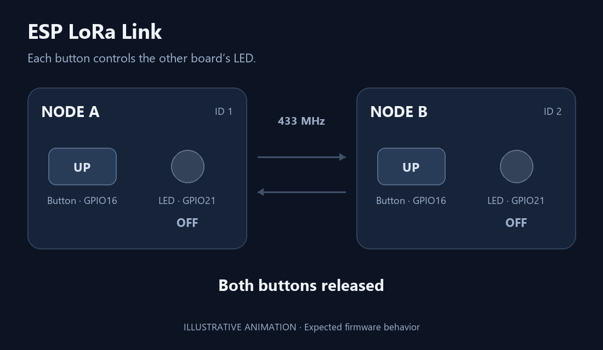
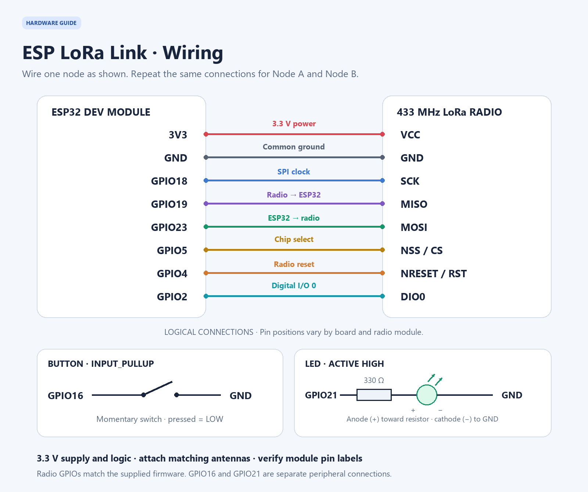

<div align="center">

# ESP LoRa Link

Bidirectional button-to-LED control over LoRa: hold a button on one board to light the other board's LED, then release it to turn the LED off.

[](https://docs.espressif.com/projects/arduino-esp32/en/latest/)
[](https://www.arduino.cc/en/software)
[](LoRaButtonNodeA/LoRaButtonNodeA.ino)
[](#radio-settings)
[](https://github.com/sandeepmistry/arduino-LoRa)
[](LICENSE.md)
[](https://github.com/pravennn08/esp-lora-link/actions/workflows/ci.yml)

[Get started](#getting-started) · [Wiring](#wiring) · [Run the demo](#run-the-demo) · [Troubleshooting](#troubleshooting) · [Contributing](CONTRIBUTING.md) · [Changelog](CHANGELOG.md)

</div>

---

## Overview

ESP LoRa Link connects two ESP-WROOM-32 / ESP32 Dev Module boards using point-to-point LoRa. Each node sends its button state and applies the peer's state to its own LED. No Wi-Fi, internet connection, or LoRaWAN gateway is needed.

```text
Node A button ─────── LoRa ───────► Node B LED
Node A LED    ◄────── LoRa ──────── Node B button
```



*Illustrative animation of the intended behavior; hardware results depend on your setup.*

### Features

- **Two-way control** — either board can send and receive button states.
- **Debounced input** — button changes must remain stable for 30 ms.
- **Delivery feedback** — acknowledgements report the LED state applied by the peer.
- **Periodic state refresh** — updates continue while the button is held or released.
- **Stale-state handling** — an illuminated LED turns off after 2.5 seconds without a fresh peer state.
- **Packet checks** — fixed-size packets, node IDs, boot sessions, sequence checks, and radio CRC.
- **Serial diagnostics** — button events, received states, ACKs, RSSI, SNR, and round-trip timing.

## Hardware

For the complete two-node demo:

| Component                         | Quantity  | Notes                                                                             |
| --------------------------------- | --------- | --------------------------------------------------------------------------------- |
| ESP-WROOM-32 development board    | 2         | Select **ESP32 Dev Module** in Arduino IDE                                        |
| 433 MHz SX127x LoRa module        | 2         | For example, an SX1278 module compatible with the Arduino LoRa library            |
| Matching 433 MHz antenna          | 2         | Attach before powering the radios                                                 |
| Momentary push button             | 2         | One per board                                                                     |
| LED and current-limiting resistor | 2 each    | One external LED per board; choose a resistor suitable for the LED, such as 330 Ω |
| Breadboard and jumper wires       | As needed | Repeat the same wiring for both nodes                                             |
| USB data cable                    | 2         | For power, upload, and serial monitoring                                          |

The [Arduino LoRa library](https://github.com/sandeepmistry/arduino-LoRa#compatible-hardware) supports SX1276/77/78/79 radios. Choose modules and antennas that support the configured frequency. Use a stable **3.3 V** radio supply and 3.3 V logic; check your module's pinout before wiring.

## Software dependencies

| Dependency | Version / purpose |
| --- | --- |
| [LoRa by Sandeep Mistry](https://github.com/sandeepmistry/arduino-LoRa) | **0.8.0** — radio communication through `LoRa.h` |
| [ESP32 by Espressif Systems](https://docs.espressif.com/projects/arduino-esp32/en/latest/) | **3.3.0** in CI — ESP32 board support, SPI, and system headers |
| Arduino IDE or Arduino CLI | IDE for interactive upload; CLI **1.x** in CI |

The LoRa dependency is the **LoRa 0.8.0** package shown in Arduino Library Manager, authored by **Sandeep Mistry**. Install it through Library Manager or with `arduino-cli lib install "LoRa@0.8.0"`. Its source and MIT license are available in the [upstream repository](https://github.com/sandeepmistry/arduino-LoRa).

## Wiring

Use these connections on **both** boards. The GPIO numbers match the supplied sketches.



*Logical connections for one node; repeat for the other. Pin placement in the diagram is illustrative, so use your module's printed labels.*

| LoRa module pin | ESP32 connection |
| --------------- | ---------------- |
| VCC             | 3V3              |
| GND             | GND              |
| SCK             | GPIO18           |
| MISO            | GPIO19           |
| MOSI            | GPIO23           |
| NSS / CS        | GPIO5            |
| NRESET / RST    | GPIO4            |
| DIO0            | GPIO2            |

| Peripheral   | Connection                                               |
| ------------ | -------------------------------------------------------- |
| Push button  | GPIO16 → button → GND                                    |
| External LED | GPIO21 → resistor → LED anode (+); LED cathode (−) → GND |

The button uses `INPUT_PULLUP`: released is HIGH and pressed is LOW. The LED is active HIGH. Each radio must share ground with its ESP32.

## Getting started

### 1. Download the project

```sh
git clone https://github.com/pravennn08/esp-lora-link.git
cd esp-lora-link
```

Alternatively, use **Code → Download ZIP** on GitHub and extract the archive.

### 2. Install Arduino IDE and ESP32 support

1. Install [Arduino IDE](https://www.arduino.cc/en/software).
2. Open **File → Preferences** and add this URL to **Additional boards manager URLs**:

   ```text
   https://espressif.github.io/arduino-esp32/package_esp32_index.json
   ```

3. Open **Boards Manager**, search for **esp32**, and install **esp32 by Espressif Systems**, selecting version **3.3.0** to match CI.
4. Select **Tools → Board → esp32 → ESP32 Dev Module** for an ESP-WROOM-32 development board.

See Espressif's [installation guide](https://docs.espressif.com/projects/arduino-esp32/en/latest/installing.html#installing-using-arduino-ide) for platform-specific details.

### 3. Install the LoRa library

In Arduino IDE, open **Library Manager**, search for **LoRa**, and install **LoRa by Sandeep Mistry**, selecting version **0.8.0**. See the library's [installation instructions](https://github.com/sandeepmistry/arduino-LoRa#installation).

`SPI.h`, `esp_system.h`, and `esp_random.h` come with the ESP32 board package. `LoRaButtonLink.h` is included in this repository.

### 4. Open the sketches

The sketch folders already match their main `.ino` filenames, so you can open them directly in Arduino IDE:

- Node A: `LoRaButtonNodeA/LoRaButtonNodeA.ino`
- Node B: `LoRaButtonNodeB/LoRaButtonNodeB.ino`

Keep `LoRaButtonLink.h` beside its `.ino` in each folder. No additional copying or folder preparation is needed.

### 5. Upload Node A

1. Connect the first ESP32 using a USB data cable.
2. Open `LoRaButtonNodeA/LoRaButtonNodeA.ino` in Arduino IDE.
3. Confirm the board is **ESP32 Dev Module** and choose its port under **Tools → Port**.
4. Click **Verify**, then **Upload**.
5. Open **Serial Monitor**, set the baud rate to **115200**, and press **EN / RESET** to see the startup messages.

### 6. Upload Node B

Repeat the upload steps for the second ESP32 using `LoRaButtonNodeB/LoRaButtonNodeB.ino` and that board's serial port.

Node A has `NODE_ID = 1`; Node B has `NODE_ID = 2`. Upload the correct sketch to each board. The `COM6` and `COM3` comments in the source are examples; select the actual ports on your computer.

## Run the demo

1. Power both wired nodes with antennas connected.
2. Confirm each board prints `[READY]` at **115200 baud**.
3. Hold **Node A's button**: **Node B's LED** should turn on.
4. Release Node A's button: Node B's LED should turn off.
5. Repeat using **Node B's button** to control **Node A's LED**.
6. To check the timeout, hold Node A's button until Node B's LED lights, then remove power from Node A. Node B should turn its LED off about **2.5 seconds after the last fresh state**.

Both directions can operate during the same session. LoRa transmissions share the radio channel, so packet loss and temporary collisions are possible.

### Example serial output

Startup:

```text
[READY] 433 MHz SF7 BW125k CRC=on TX=14 dBm button=16 LED=21
[USE] Hold your button to light the OTHER board's LED; release to turn it off.
```

An illustrative button press on Node A:

```text
[BUTTON] PRESSED -> peer LED ON
[STATE TX] to=2 seq=7 button=DOWN
[ACK] seq=7 peerLED=ON RTT=120 ms RSSI=-60 dBm SNR=9.50 dB
```

The corresponding message on Node B:

```text
[STATE RX] from=1 seq=7 localLED=ON RSSI=-60 dBm SNR=9.50 dB
```

Sequence numbers, signal readings, and timing vary. An `[ACK]` confirms a matching response from the peer; `[NO ACK]` means delivery or the return path was not confirmed.

## Radio settings

Both sketches use the following defaults:

| Setting                     | Value                                                  |
| --------------------------- | ------------------------------------------------------ |
| Frequency                   | 433 MHz (`433000000L`)                                 |
| Transmit power              | 14 dBm                                                 |
| Spreading factor            | SF7                                                    |
| Bandwidth                   | 125 kHz                                                |
| Coding rate                 | 4/5                                                    |
| Preamble                    | 8 symbols                                              |
| Sync word                   | `0x12`                                                 |
| Radio CRC                   | Enabled                                                |
| SPI frequency               | 1 MHz                                                  |
| Packet size                 | 16 bytes                                               |
| Held-state refresh          | 750 ms + 0–200 ms jitter                               |
| Released-state refresh      | 3000 ms + 0–200 ms jitter                              |
| ACK timeout                 | 500 ms after transmission completes                    |
| Transmit-completion timeout | 2000 ms                                                |
| LED timeout                 | 2500 ms without a fresh peer state while the LED is on |

Change radio parameters on **both nodes** together. Keep their node IDs distinct. GPIO mappings and timing constants are near the top of each `.ino`; packet handling and `LINK_TIMEOUT_MS` are in each `LoRaButtonLink.h`. Keep both header copies synchronized when changing the protocol.

## Project structure

```text
esp-lora-link/
├── .github/
│   ├── ISSUE_TEMPLATE/
│   │   └── bug_report.yml
│   ├── workflows/
│   │   └── ci.yml
│   └── pull_request_template.md
├── docs/
│   ├── demo.gif              # Illustrative behavior animation
│   └── wiring.png            # Logical wiring for each node
├── LoRaButtonNodeA/
│   ├── LoRaButtonNodeA.ino    # Node 1 firmware
│   └── LoRaButtonLink.h       # Shared protocol implementation
├── LoRaButtonNodeB/
│   ├── LoRaButtonNodeB.ino    # Node 2 firmware
│   └── LoRaButtonLink.h       # Matching protocol copy
├── .gitignore
├── CHANGELOG.md
├── CONTRIBUTING.md
├── LICENSE.md
└── README.md
```

## Continuous integration

[GitHub Actions CI](https://github.com/pravennn08/esp-lora-link/actions/workflows/ci.yml) compiles both sketches for **ESP32 Dev Module** on every push and pull request. You can also run it manually from the repository's **Actions → CI → Run workflow** menu after the workflow is on the default branch.

The workflow uses Arduino CLI 1.x, ESP32 core **3.3.0**, and LoRa **0.8.0**. Each node gets its own build job and compiles directly from its matching sketch folder. Update the dependency versions in `.github/workflows/ci.yml` when changing the build environment.

CI checks compilation; use the physical two-board demo above to verify wiring and radio communication.

## Troubleshooting

| Symptom                                       | What to check                                                                                                                                                      |
| --------------------------------------------- | ------------------------------------------------------------------------------------------------------------------------------------------------------------------ |
| `LoRa.h: No such file or directory`           | Install **LoRa by Sandeep Mistry** in Library Manager.                                                                                                             |
| `LoRaButtonLink.h: No such file or directory` | Keep the matching header in the same folder as the `.ino`.                                                                                              |
| Arduino asks to move the sketch               | Extract the complete repository and open the `.ino` inside its matching folder, as shown in step 4.                                                                                           |
| Upload cannot connect                         | Confirm the board, USB data cable, and port. If necessary, hold **BOOT** while the uploader connects, then release it.                                             |
| `[INIT FAIL] RegVersion=...`                  | Check 3.3 V power, ground, SPI wiring, NSS, reset, and module compatibility. The sketch expects register version `0x12`; press **EN / RESET** after fixing wiring. |
| `[NO ACK]`                                    | Confirm the peer is powered, running the other node ID, and using matching radio settings. Check antennas and reduce distance for the initial test.                |
| LED does not respond                          | Check LED polarity, resistor, GPIO21 wiring, and button-to-GND wiring on GPIO16. The button controls the **other board's LED**.                                    |
| `[LINK TIMEOUT]`                              | Fresh peer states stopped arriving while the LED was on. Check peer power, interference, range, and radio wiring.                                                  |
| Unreadable serial text                        | Set Serial Monitor to **115200 baud**.                                                                                                                             |

## Contributing

Read [CONTRIBUTING.md](CONTRIBUTING.md) for the build commands, testing guidance, and pull request process. Report problems through the [bug-report form](https://github.com/pravennn08/esp-lora-link/issues/new?template=bug_report.yml), including your hardware, wiring, dependency versions, and logs.

See [CHANGELOG.md](CHANGELOG.md) for changes awaiting release.

## License

Released under the [MIT License](LICENSE.md).

Copyright © 2026 Engr. Raven C. Magbanua.
